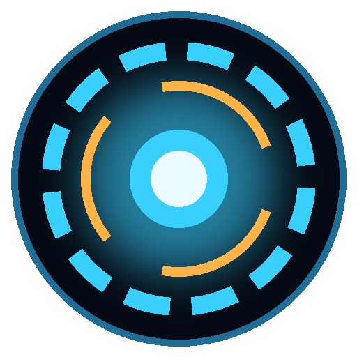

# DraveJavis

**Een persoonlijke spraakassistent die helemaal op je eigen pc draait.**
*A personal voice assistant that runs entirely on your own computer.* (English below)

Geen cloud, geen account, geen abonnement. Je praat met DraveJavis via je microfoon of je typt, en hij antwoordt hardop.
Alles (taalmodel, stem en spraakherkenning) draait lokaal.

**[⬇️ Download voor Windows](https://github.com/mbrv4ever/DraveJavis/releases/latest/download/DraveJavis-1.2.0-Windows.zip)** · [Snelgids (PDF)](https://github.com/mbrv4ever/DraveJavis/releases/latest/download/DraveJavis-Snelgids.pdf) · [Hoe installeer ik het?](#️-downloaden-en-starten-makkelijk-geen-python-nodig)

## 🎬 Uitlegvideo

[▶ Bekijk de uitlegvideo](https://dravenlock.nl/video/DraveJavis.mp4) (ongeveer 2 minuten, Nederlands)

## Wat kan hij?
- **Praten en luisteren**: houd de microfoonknop (of **F2**) ingedrukt, praat, en laat los. Hij antwoordt met een neurale stem, zin voor zin, terwijl het antwoord nog binnenkomt.
- **Eigen motor** (nieuw in 1.2): DraveJavis start zelf zijn eigen taalmodel (llama.cpp op de videokaart, met
  het model **Qwen2.5 3B**). Eenmalig downloaden via *Instellingen → Motor downloaden...* naar een map die jij kiest
  (ongeveer 2 GB). Bovenin het venster zie je altijd welk model er draait. Geen losse app meer nodig.
- **Geheugen in laatjes** (nieuw in 1.2): wat hij onthoudt, legt hij per onderwerp in een laatje (Mensen, Dieren,
  Interesses, Eten, Werk, Thuis, Afspraken, Overig) en bij een vraag pakt hij eerst het juiste laatje.
- **Portable** (nieuw in 1.2): al je gegevens staan in de map `DraveJavis-data` naast het programma, niet meer in AppData.
- **Of een andere server**: werkt ook met elke OpenAI-compatibele server op je pc:
  [Llama-app (llama.cpp)](https://github.com/ggml-org/llama.cpp), LM Studio, Ollama, Jan of llama.cpp-server.
  Kiest zelf een geladen model (of stel er een vast in).
- **Zelf direct**: de tijd en de datum, een **timer** ("zet een timer van 5 minuten"), dingen **onthouden**
  ("onthoud dat ...", "wat heb je onthouden?", "vergeet ...") en een **website openen** ("open youtube").
- **Zelf online zoeken**: vraag naar het weer, nieuws of openingstijden, of zeg "zoek op internet naar ...".
  DraveJavis zoekt zelf (DuckDuckGo), leest de beste pagina's, vertelt het antwoord en zet de **bronnen als links**
  eronder. Je browser gaat niet open. Alleen de zoekvraag gaat het internet op (uit te zetten bij Instellingen).
- **Ochtendoverzicht** (nieuw in 1.1): zeg *"goedemorgen"* en hij vertelt het **weer** (ook storm, regen en
  windstoten in gewone taal), je **afspraken uit [DraveAgenda](https://github.com/mbrv4ever/DraveAgenda)** en wat je
  voor vandaag hebt genoteerd. Bij de eerste start van de dag doet hij het vanzelf (uit te zetten).
  Stel je plaats in met *"mijn plaats is Utrecht"*.
- **Geheugen als gewone tekstbestanden** (nieuw in 1.1): wat hij onthoudt, je notities (*"noteer ..."*) en de
  gesprekken per dag staan in leesbare `.md`-bestanden die je zelf mag aanpassen, met een snelle zoekindex (SQLite)
  ernaast. Vraag *"wat weet je over ...?"* en hij zoekt in alles wat je eerder zei of noteerde.
- **Duidelijke stem** (nieuw in 1.1.1): standaard de stem **Leon**, en hij spreekt websites, e-mailadressen en
  afkortingen voluit uit (*dravenlock.nl* wordt "dravenlock punt en el", *80 km/u* wordt "80 kilometer per uur").
- **Nederlands en Engels.** Eigen naam, aanspreekvorm en persoonlijkheid in te stellen.
- Grote, duidelijke letters en een donker scherm met een bewegende kern die laat zien wat hij doet
  (klaar, luistert, denkt na, spreekt).

## ⬇️ Downloaden en starten (makkelijk, geen Python nodig)

### [👉 Download DraveJavis 1.2.0 voor Windows](https://github.com/mbrv4ever/DraveJavis/releases/latest/download/DraveJavis-1.2.0-Windows.zip)

1. Klik op de link hierboven. Je downloadt een zip-bestand (± 130 MB).
2. **Pak de zip uit**: rechtsklik op het bestand → **Alles uitpakken...**
3. DraveJavis heeft een **brein** nodig: een gratis programma dat een taalmodel op je pc draait.
   Installeer bijvoorbeeld **[LM Studio](https://lmstudio.ai)** of de **Llama-app**, en download daarin een model
   (voor Nederlands bijvoorbeeld *Fietje 2*, voor Engels *Gemma 3* of *Qwen 2.5*). Laat dat programma open staan.
4. Open de uitgepakte map en dubbelklik op **DraveJavis.exe**.
5. Bij **Instellingen** kies je je taalmodel-programma (LM Studio, Llama-app, Ollama ...) en vul je je naam in.

De eerste keer haalt DraveJavis zelf de stem en de spraakherkenning op; dat duurt even. Daarna werkt alles op je eigen pc.

📖 **Alle commando's en uitleg:** [DraveJavis-Snelgids.pdf](https://github.com/mbrv4ever/DraveJavis/releases/latest/download/DraveJavis-Snelgids.pdf)

> Windows laat bij de eerste keer misschien een blauw scherm zien ("Windows heeft uw pc beschermd"), omdat de app
> nog onbekend is. Klik dan op **Meer informatie** → **Toch uitvoeren**.

## Voor ontwikkelaars: vanaf de broncode
1. Installeer **Python 3.10 – 3.13** van [python.org](https://www.python.org/downloads/).
2. Dubbelklik **`Installeer-DraveJavis.bat`** (maakt een `.venv` en installeert de onderdelen).
3. Start met **`Start-DraveJavis.bat`**.
4. Zelf een EXE maken: `Bouw-DraveJavis-EXE.bat` → `dist\DraveJavis\DraveJavis.exe`.

## Waar staan mijn gegevens?
In `%APPDATA%\DraveJavis` (Windows) of `~/.drave_javis`: instellingen, het lopende gesprek en de
spraakherkenningsmodellen. Het geheugen staat in de map **`Geheugen`** daarin: `feiten.md`, `notities\` en
`gesprekken\` (gewone tekstbestanden), plus `zoekindex.db`. Gesprekken bewaren kun je uitzetten bij Instellingen. Niets verlaat je pc, behalve een zoekvraag als hij online zoekt (uit te zetten).

## Onderdelen en dank
| Onderdeel | Waarvoor | Licentie |
|---|---|---|
| [PyQt6](https://www.riverbankcomputing.com/software/pyqt/) | het venster | GPL v3 |
| [neuvoice](https://github.com/thelamapi/neuvoice) | de stem (tekst naar spraak) | OpenRAIL |
| [faster-whisper](https://github.com/SYSTRAN/faster-whisper) / OpenAI Whisper | spraakherkenning | MIT |
| [sounddevice](https://python-sounddevice.readthedocs.io/) | microfoon en luidspreker | MIT |
| [ONNX Runtime](https://onnxruntime.ai/) | rekent de stem uit | MIT |

DraveJavis is een eigen project, niet verbonden aan Marvel of Iron Man.

## Licentie
DraveJavis is vrije software onder de **GNU General Public License v3.0** (zie [LICENSE](LICENSE)).
Je mag hem gratis gebruiken, delen en aanpassen. Deel je een aangepaste versie, dan moet die ook onder de GPL-3.0
en met de broncode beschikbaar zijn. Copyright © 2026 Dravenlock (Roger & Claudio).

📖 Uitleg met alle commando's: **[DraveJavis-Snelgids.pdf](DraveJavis-Snelgids.pdf)**

---

## English

**DraveJavis** is a local, private voice assistant for Windows. Hold the microphone button (or **F2**) and talk,
or just type. It answers out loud with a neural voice (neuvoice), understands speech with faster-whisper, and thinks
with any local OpenAI-compatible model server (Llama app / llama.cpp, LM Studio, Ollama, Jan).
Built-in skills: time, date, timers, remembering facts, opening websites, and its own web search (DuckDuckGo) with source links. New in 1.1: a spoken **morning briefing** (weather + DraveAgenda appointments) and a **memory made of plain Markdown files** with a fast SQLite search index. New in 1.1.1: the default voice is **Leon**, and Dutch speech reads web addresses, e-mail addresses and abbreviations out in full. Dutch and English.

**Easy install:** [download the Windows zip](https://github.com/mbrv4ever/DraveJavis/releases/latest/download/DraveJavis-1.2.0-Windows.zip),
unzip it, start a local model app (e.g. LM Studio) with a model, and double-click **DraveJavis.exe**. No Python needed.
**From source:** Python 3.10–3.13 → `Installeer-DraveJavis.bat` → `Start-DraveJavis.bat`.

Made by **Dravenlock** (Roger & Claudio). Licensed under **GPL-3.0**. Donations welcome, never required.
